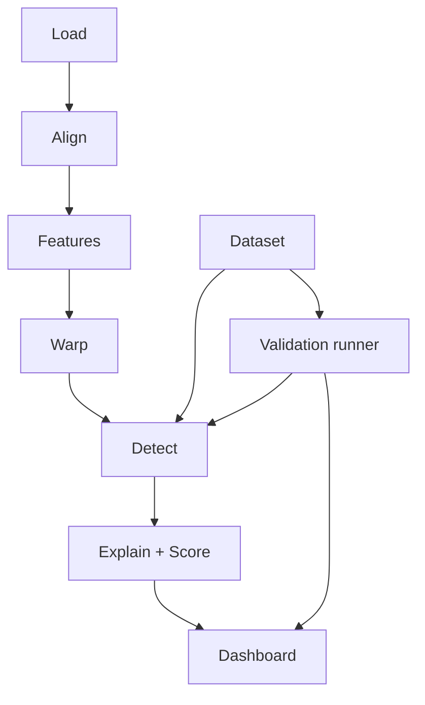

# FlawScope

Counterpointing speech analytics and temporal flaw grounding against reference spoken deliveries.

[](#)
[](#)
[](#)

## The Problem

Speech coaching and oral performance assessment traditionally rely on subjective human impressions, creating inconsistent evaluations that lack transparent acoustic grounding. Currently, no public benchmark systematically pairs clean baseline orations with controlled, temporally bounded speech delivery flaws spanning a calibrated spectrum from near-perfect to egregious. Without aligned acoustic counterpoints, speakers cannot pinpoint precisely when their cadence, pitch, or clarity faltered. FlawScope addresses this gap through reproducible, explainable scoring that measures acoustic divergence directly against reference performances.

## What FlawScope Does

FlawScope analyzes spoken delivery against a baseline recording of the same transcript through an automated six-step sequence:

1. **Align**: Matches transcript text to audio word boundaries for both baseline and participant recordings using speech recognition timestamps and sequence alignment.
2. **Measure**: Extracts acoustic features per frame (100 Hz) and per word, including F0 pitch contours (semitones), loudness intensity (dB), 12 MFCC coefficients, log-mel FFT spectrograms, speech tempo, and pauses.
3. **Compare**: Time-warps baseline acoustic profiles onto the participant timeline using matched word anchors to compare word-level metrics over identical lexical windows.
4. **Flag**: Detects delivery flaws when localized metric deltas deviate past configured Z-score thresholds or pause limits, merging proximal occurrences into coherent flaw segments.
5. **Explain**: Generates deterministic, human-readable explanations and practical recommendations detailing the exact mathematical differences.
6. **Score**: Evaluates performance on a standardized 0-100 rubric across five core dimensions (pace, intonation, volume, pausing, clarity) and calculates a weighted overall rating.

### Example Explanation

> Pitch variation dropped to 0.8 semitones (baseline: 2.6 semitones, -69%, z = -2.1), resulting in flat, monotone delivery.

## Features

- **Sidebar**: Demo-pair selector or upload interface for baseline audio, participant audio, and reference transcript; live sensitivity slider to adjust detection Z-scores; one-click analysis trigger.
- **Overview Tab**: Overall score card alongside five rubric dimension scores (0-100), multi-axis radar chart, flaw count distribution by category, aligned transcript strip with highlighted flawed words, and highlighted top-3 critical flaws.
- **Timeline Tab**: Three stacked, synchronized time-series plots (pitch, loudness, speech rate) showing participant curves (solid) against time-warped baseline curves (dashed), color-coded flaw regions, word hover tooltips, and interactive audio playback zoomed to selected flaws.
- **Flaws Panel**: Sortable table and expandable cards detailing timestamps, flaw type, severity index (0-1), metric values, deterministic explanations, actionable recommendations, and side-by-side audio playback of flawed participant segments and matching baseline excerpts; CSV and JSON export options.
- **Spectrogram & MFCC Views**: Time-frequency spectrogram and 12-band MFCC visualizations marked with flaw bounding boxes.
- **Validation Tab**: Side-by-side review of detected flaws versus ground-truth annotations, precision and recall metrics per flaw type, and score progression across the contrastive severity ladder.
- **Method Tab**: Mathematical rationale, detection formulas, and live active thresholds loaded directly from `config.py`.


<!-- add after the demo run -->

## Architecture

The following diagram illustrates how audio and transcripts pass through the signal processing engine to the interactive dashboard, as well as how the contrastive dataset and evaluation suite interact with the detection system:



## Flaw Types and Detection Rules

Detection runs across a 5-word window (the target word plus two words on either side). Baseline and participant are compared on identical words so differences remain valid regardless of duration discrepancies. Default threshold is `Z = 1.5` in `config.py`.

| Flaw | Metric | Flag rule | Why it matters |
| :--- | :--- | :--- | :--- |
| MONOTONE | std of F0 (semitones) in a 5-word window | d = (m_p - m_b)/s_b <= -Z | Flat pitch removes emphasis and intent cues |
| TOO_FAST | syllables per second of speech time | d >= +Z | Rushed delivery; listeners cannot process the content |
| TOO_SLOW | syllables per second of speech time | d <= -Z | Dragging pace loses energy and attention |
| LONG_PAUSE | silence between adjacent words | gap_p >= 0.9 s and gap_p - gap_b >= 0.5 s | Hesitation or lost thread |
| LOW_VOLUME | mean loudness (dB) vs own median speech level | d <= -Z and drop >= 4 dB | Trailing off; the message is not carried to the back of the room |
| UNCLEAR_ARTICULATION | DTW cost between word-matched MFCC sequences | robust z (median/MAD) >= Z + 0.5 | Mumbled or smeared consonants |

### Severity and Region Logic

- **Severity calculation**: For general window deviation, `severity = clip(|d| / (2Z), 0, 1)`. For `LONG_PAUSE`, `severity = clip((gap_p - gap_b) / 2.5, 0, 1)`.
- **Region merging**: Flagged words separated by at most 1 word are merged into continuous flaw regions.
- **Duration filtering**: Merged regions shorter than 0.6 seconds are dropped, with the exception of pause flaws.

## Scoring Rubric

Dimension scores (0-100) quantify delivery quality based on accumulated flaw severity and duration relative to speech time:

$$\text{Dimension score} = 100 \times \exp\left(-3 \times \frac{\sum (\text{severity} \times \text{duration})}{T_{\text{speech}}}\right)$$

### Dimensions and Weights

- **Pace** (Weight: 0.25): Evaluates `TOO_FAST` and `TOO_SLOW`.
- **Intonation** (Weight: 0.25): Evaluates `MONOTONE`.
- **Volume** (Weight: 0.15): Evaluates `LOW_VOLUME`.
- **Pausing** (Weight: 0.15): Evaluates `LONG_PAUSE`.
- **Clarity** (Weight: 0.20): Evaluates `UNCLEAR_ARTICULATION`.

### Overall Score Formula

$$\text{Overall} = 0.25 \times \text{Pace} + 0.25 \times \text{Intonation} + 0.15 \times \text{Volume} + 0.15 \times \text{Pausing} + 0.20 \times \text{Clarity}$$

All scoring is deterministic: fixed random seeds, temperature 0, and no stochastic variations.

## Dataset and Validation

### Contrastive Severity Ladder

The dataset provides paired recordings of identical spoken texts:
- **Baseline clips**: At least 3 clean recordings (30-60 seconds, single speaker, English, public-domain or properly licensed) paired with human-verified transcript files (`.txt`).
- **Severity ladder**: For each baseline clip, a seeded flaw-injection pipeline synthesizes versions of the exact same text across four calibrated levels:
  - Level 1 (near-perfect): 1 injected flaw piece.
  - Level 2 (mild): 2 injected flaw pieces.
  - Level 3 (moderate): 4 injected flaw pieces.
  - Level 4 (egregious): 6 injected flaw pieces.
- **Single-flaw set**: For `clip01`, six isolated Level 3 files containing exactly one flaw type each.
- **Self-recorded test**: At least 2 human self-recorded flawed reads of one transcript for real-world validation.

### Labels and Manifests

- `dataset/labels.csv`: Ground-truth annotations with columns `pair_id, file, role, source, baseline_file, transcript_file, flaw_type, start_s, end_s, severity_level, param, notes`.
- `dataset/pairs.json`: Comprehensive manifest indexing every baseline and participant pair.

### Validation Checks

- **Precision & Recall**: `eval/run_eval.py` matches detected intervals against ground-truth time boundaries in `labels.csv` to calculate precision and recall per flaw type.
- **Score-vs-Severity Monotonicity**: Verifies that overall and dimension scores strictly decrease from Level 1 down to Level 4 across all test pairs.

### Licensing Note

Modified audio must originate from public-domain or permissively licensed recordings. TED talks are licensed under CC BY-NC-ND (no derivatives) and cannot be used in the synthetic flaw modification set. Source attribution and licensing information are recorded for every audio clip.

## Quick Start

```bash
python -m venv .venv
# activate the virtual environment:
# Windows (PowerShell): .venv\Scripts\Activate.ps1
# Windows (cmd): .venv\Scripts\activate.bat
# Linux/macOS: source .venv/bin/activate
```

```bash
pip install -r requirements.txt
```

One-off model download:
```bash
python -c "from faster_whisper import WhisperModel; WhisperModel('base.en', device='cpu', compute_type='int8')"
```

```bash
streamlit run app/main.py
```

Mock mode (no engine needed):
```bash
set FLAWSCOPE_MOCK=1
streamlit run app/main.py
```

Validation:
```bash
python dataset/inject_flaws.py --all --seed 7
python eval/run_eval.py --quick
```

Tests:
```bash
pytest -q
```

## Repository Layout

```text
flawscope/
  AGENTS.md  README.md  requirements.txt  config.py            (A)
  contracts/   schema.py  make_mock.py  mock_result.json       (A)
  core/        audio_io alignment features warp detectors
               explain scoring cache pipeline                  (A)
  app/         main.py  ui/ (theme adapter charts tab_*.py)    (B)
  dataset/     raw/ transcripts/ generated/ labels.csv
               pairs.json inject_flaws.py ...                  (B)
  eval/        run_eval.py  results.json                       (B)
  tests/       test_core_*.py (A)    test_dataset.py (B)
  docs/        tuning_log.md                                   (A)
```

- `AGENTS.md`, `README.md`, `requirements.txt`, `config.py` (Owner A): Repository instructions, project documentation, package dependencies, and global detector parameters.
- `contracts/` (Owner A): Data interchange schemas (`schema.py`), mock payload generator (`make_mock.py`), and frozen test fixture (`mock_result.json`).
- `core/` (Owner A): Algorithmic engine including audio I/O, forced alignment, feature extraction, time-warping, flaw detectors, explainability generator, scoring logic, caching, and main pipeline.
- `app/` (Owner B): Streamlit application interface (`main.py`) and UI components (`ui/` containing theme adapters, plotting charts, and tab views).
- `dataset/` (Owner B): Baseline recordings (`raw/`), verified transcripts (`transcripts/`), synthetic audio (`generated/`), ground-truth annotations (`labels.csv`), pair registry (`pairs.json`), and injection script (`inject_flaws.py`).
- `eval/` (Owner B): Benchmark test runner (`run_eval.py`) and validation outputs (`results.json`).
- `tests/` (Owners A & B): Test suites verifying core signal processing (`test_core_*.py`, Owner A) and dataset pipelines (`test_dataset.py`, Owner B).
- `docs/` (Owner A): Project documentation, parameter calibration records (`tuning_log.md`), and the Functional Requirements Document (`FRD.md`).

## Project Status

Update this list at the final sync point.

- [ ] FR-D1: Good baseline audio clips and verified transcripts
- [ ] FR-D2: Seeded, reproducible flaw-injection severity ladder (L1-L4)
- [ ] FR-D3: Human self-recorded flawed reads
- [ ] FR-D4: Ground-truth bounded labels (labels.csv, pairs.json)
- [ ] FR-A1: Word-level audio and transcript alignment
- [ ] FR-A2: Frame-level (100 Hz) and word-level acoustic feature extraction
- [ ] FR-A3: Six-type speech flaw detection engine
- [ ] FR-A4: Deterministic plain-English explanations and recommendations
- [ ] FR-A5: Reproducible 0-100 rubric scoring system
- [ ] FR-A6: Feature hashing, cache management, and CPU performance targets
- [ ] FR-A7: Configurable true CTC forced-alignment backend fallback
- [ ] FR-U1: Audio and transcript upload and demo-pair selector
- [ ] FR-U2: Time-series overlay with shaded flaw regions and word hover
- [ ] FR-U3: Interactive flaw cards with audio playback and timeline zoom
- [ ] FR-U4: Score summary cards and radar chart visualization
- [ ] FR-U5: Aligned transcript strip with color-coded flaw highlights
- [ ] FR-U6: Time-frequency spectrogram and MFCC inspection views
- [ ] FR-U7: Validation tab for precision/recall and severity ladder review
- [ ] FR-U8: Live method tab displaying active formulas and thresholds
- [ ] FR-U9: Real-time sensitivity Z-score slider

## Limitations and Next Steps

### Limitations

- **Speaker similarity**: Pitch and speech rate comparisons assume identical or similar speaker profiles. Articulation detection uses robust participant-relative z-scores (median/MAD) to accommodate inter-speaker voice differences.
- **Hardware & Language**: Restricted to English speech and laptop CPU execution.

### Out of Scope

- Multi-language support, live streaming analysis, user accounts, production cloud deployment, speaker identification, and content or rhetorical quality evaluation.

### Next Steps

- Implement a true CTC forced-alignment backend behind a configuration flag.
- Expand baseline datasets to cover diverse speaker demographics and accents.
- Develop interactive coaching drills tailored to detected delivery flaws.

## Team

| Team Member | Subsystem | Ownership & Responsibilities |
| :--- | :--- | :--- |
| `<Name A>` | Signal Engine | Audio I/O, alignment, feature extraction, time-warping, detectors, explainability, scoring, contracts |
| `<Name B>` | Data and Dashboard | Baseline clips, flaw injection, ground-truth labels, Streamlit UI, visual timelines, evaluation runner |

## Data Attribution and Licence

| Clip ID | Speaker / Source | Title / URL | Licence | Notes |
| :--- | :--- | :--- | :--- | :--- |
| `clip01` | Placeholder Source A | Source Title A | Public Domain / CC BY | Baseline recording (30-60 s) |
| `clip02` | Placeholder Source B | Source Title B | Public Domain / CC BY | Baseline recording (30-60 s) |
| `clip03` | Placeholder Source C | Source Title C | Public Domain / CC BY | Baseline recording (30-60 s) |

Code licence: TBD.
